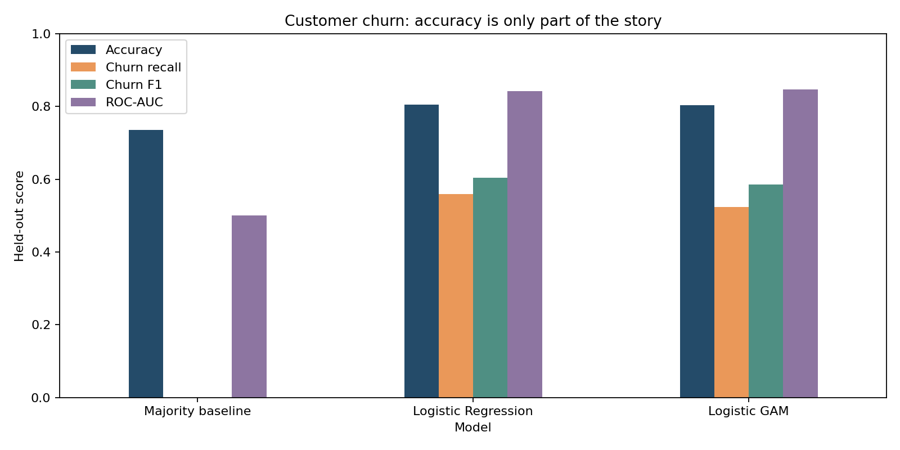
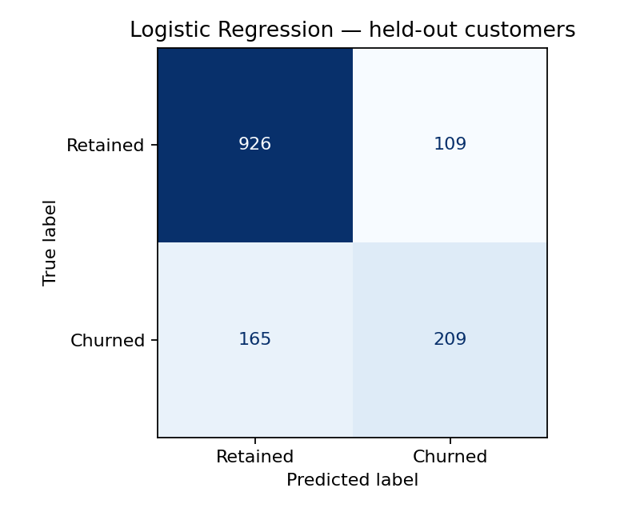
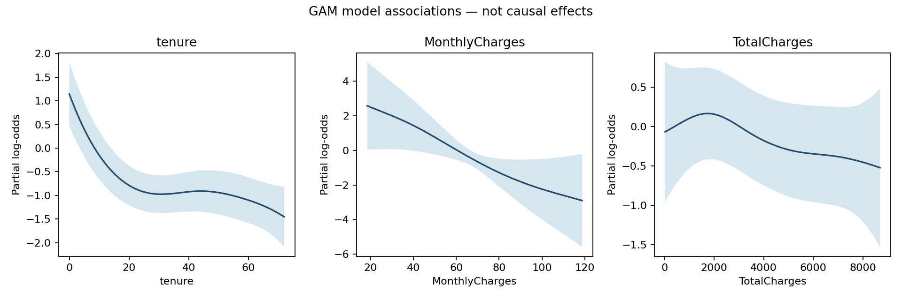

# Customer Churn Analysis with Logistic Regression & GAM

An interpretable customer-retention analysis comparing simple and nonlinear models on the public IBM Telco benchmark.

## Business value
Assess which customer attributes are associated with churn, compare a model against doing nothing beyond predicting the majority class, and show how many churners a fixed threshold actually identifies. These are retention hypotheses, not measured intervention effects.

## Results


| Model | Accuracy | Churn precision | Churn recall | Churn F1 | ROC-AUC |
| --- | --- | --- | --- | --- | --- |
| Majority baseline | 0.7346 | 0.0000 | 0.0000 | 0.0000 | 0.5000 |
| Logistic Regression | 0.8055 | 0.6572 | 0.5588 | 0.6040 | 0.8419 |
| Logistic GAM | 0.8027 | 0.6622 | 0.5241 | 0.5851 | 0.8471 |

New verification run: 7,043 rows; a stratified 80/20 split; seed 42; churn is the positive class and the decision threshold is 0.5. Imputers, scaling and encoders are fitted only on training rows. This replaces the earlier coursework's 81.83% accuracy claim for a different preprocessing/split configuration.

Logistic Regression has stronger churn recall at this threshold; GAM has slightly higher ROC-AUC on this split. Accuracy alone would hide the majority baseline's zero churn recall. No threshold optimization or multi-split robustness study is claimed.

## Technical approach
Pandas cleaning, scikit-learn ColumnTransformer preprocessing and Logistic Regression, and pyGAM LogisticGAM. The GAM has three numeric splines for tenure, MonthlyCharges and TotalCharges, plus factor terms for categorical indicators. Partial-effect plots use the actual feature order and original numeric scales.




Linear Regression remains an exploratory continuous-output comparison in run metadata; it is not presented as the main binary classifier. GAM effects and regression coefficients describe model associations, not causal drivers.

## Run
```bash
git clone https://github.com/YirenShen-07/CustomerChurnAnalysis.git
cd CustomerChurnAnalysis
python -m venv .venv
# macOS / Linux:
source .venv/bin/activate
# Windows PowerShell: .venv\Scripts\Activate.ps1
python -m pip install -r requirements.txt
python download_data.py
python analyze.py
```
Tested with Python 3.12. The download uses IBM's public repository and needs no login or Drive. Downloaded data is cached under data/ and excluded from Git. Source details and fingerprints: [DATA.md](DATA.md). [Notebook](customer_churn_analysis.ipynb) · [Metrics and coefficients](reports/).

## Project context
Original Duke AIPI 590 project by Yiren Shen, with an AI-assisted 2026 maintenance pass for reproducibility and evaluation. This is an educational benchmark, not evidence of deployed retention impact.
